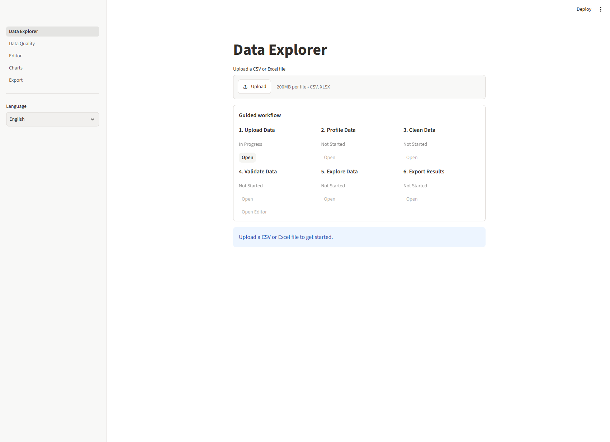
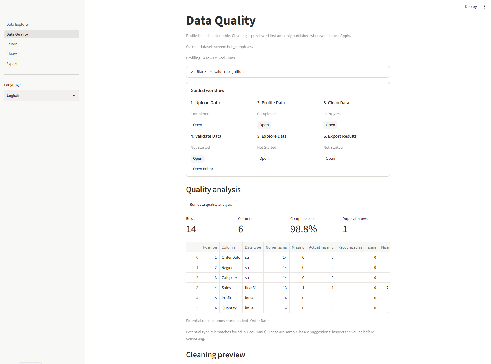
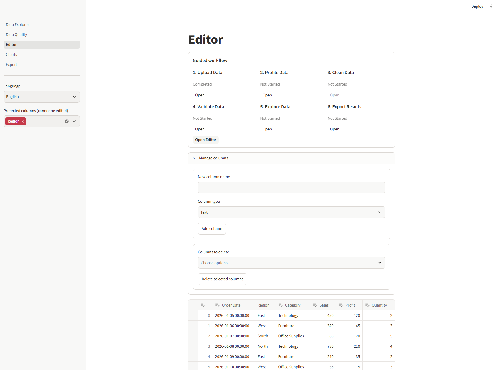
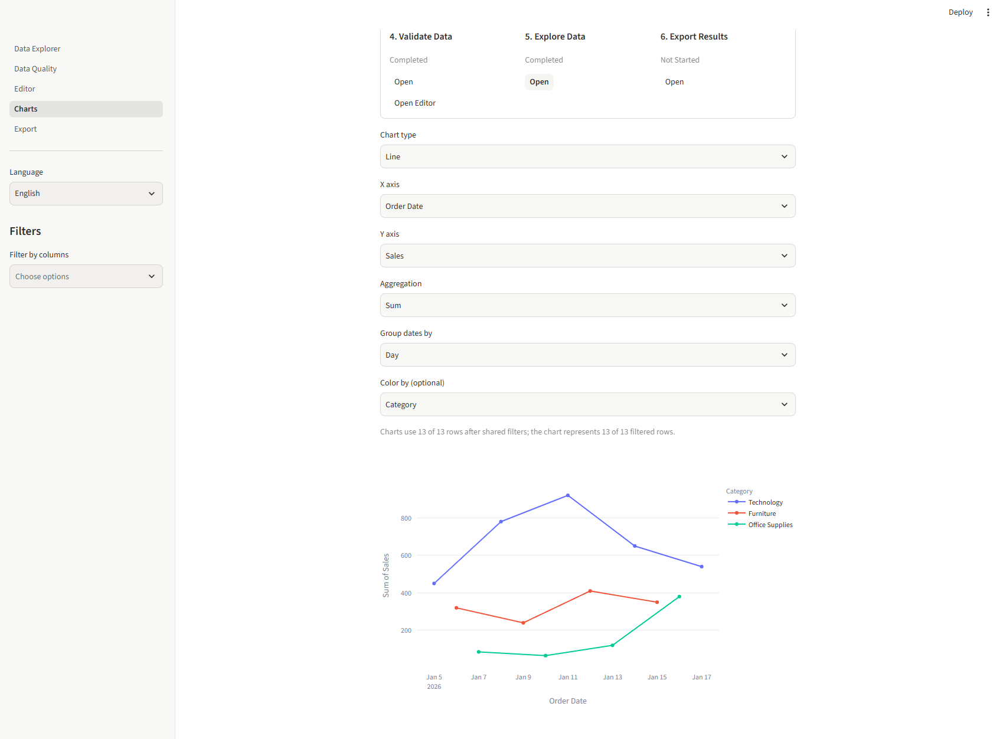
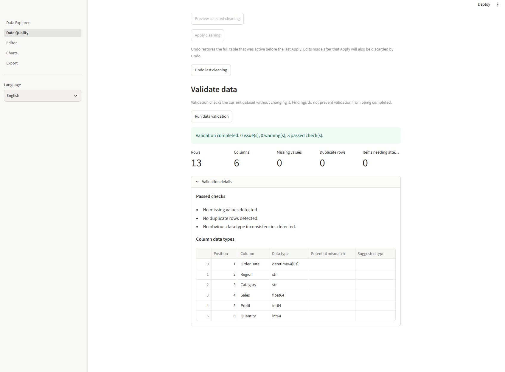
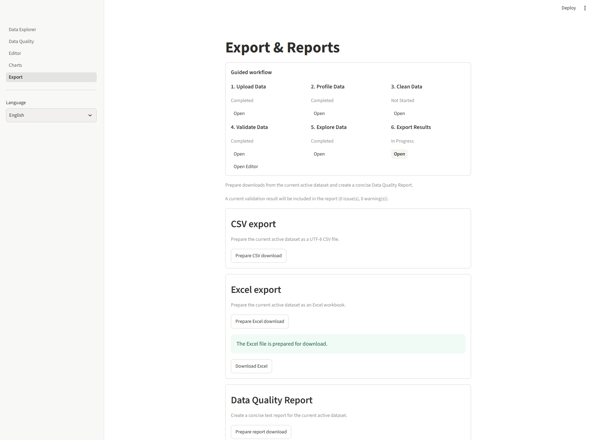

# Data Explorer

### Data Cleaning & Preparation Tool

An interactive Streamlit application designed to make data exploration, cleaning, validation, visualization, and preparation easier.

Upload your CSV or Excel files, inspect data quality, clean and transform datasets, explore patterns through interactive charts, validate results, and export your prepared data.

**Built with Python, Pandas, Streamlit, and Plotly.**


## The Story Behind the Project

Data Explorer started as a small learning project while I was studying Streamlit and exploring ways to build interactive data applications with Python.

The original idea was simple: upload a CSV file, experiment with Streamlit components, create a few interactive charts, and learn how to structure a multi-page application.

But as my knowledge and experience grew, so did the project.

What started as a practical learning exercise gradually evolved into a more comprehensive Data Cleaning & Preparation Tool. I began combining what I was learning about Python, Pandas, data analysis, and application development to build something more useful and closer to a real-world application.

The development process also became an opportunity to explore software architecture, session state management, data validation, testing, and user experience.

I used OpenAI Codex as an AI-assisted development partner throughout this journey. It helped me implement features, explore architectural solutions, troubleshoot issues, and develop automated tests. I remained involved in defining the project's direction, reviewing implementations, testing functionality, and making development decisions.

This project represents more than just a Streamlit application. It reflects my learning process, practical experimentation, and motivation to turn newly acquired knowledge into something tangible.


## Key Features

### 1. Data Upload
- Upload CSV and Excel (`.xlsx`) files.
- Automatically share the active dataset across application pages.
- Start with an upload-first interface — no predefined dataset required.

### 2. Data Quality & Profiling
- Analyze dataset dimensions, completeness, and data types.
- Identify missing values, duplicate rows, and potential type inconsistencies.
- Detect date-like text columns.
- Configure recognition of blank-like values.
- Preview cleaning operations before applying changes.

### 3. Data Cleaning & Editor
- Remove duplicate rows.
- Handle missing values using different strategies.
- Remove columns based on missing-value thresholds.
- Convert columns to Text, Integer, Number, and Date/Time.
- Trim text, collapse whitespace, and standardize text case.
- Edit cells, add or remove rows, and manage columns.
- Protect selected columns from editing.
- Preview changes before applying them and undo the last cleaning operation.

### 4. Interactive Data Visualization
- Create Bar, Line, Scatter, Histogram, and Box Plot charts.
- Generate Correlation Heatmaps using Pearson correlation.
- Choose aggregation methods: Count, Sum, Average, and Median.
- Configure grouped and stacked bar charts.
- Apply color grouping, Top N selection, and date grouping.
- Use shared filters to explore specific parts of the dataset.

### 5. Data Validation
- Check for missing values and duplicate rows.
- Inspect dataset structure and column data types.
- Identify supported data inconsistencies.
- Review validation results without modifying the original dataset.

### 6. Guided Workflow
Follow a structured process through six stages:

1. Upload Data
2. Profile Data
3. Clean Data
4. Validate Data
5. Explore Data
6. Export Results

Progress is connected to successful actions and the current dataset.

### 7. Export & Reports
- Export prepared datasets as CSV.
- Export datasets as Excel workbooks.
- Generate a Data Quality Report in plain text.
- Include available profiling and validation results in the report.

### 8. Multilingual Interface
- English interface by default.
- Russian language option.
- Language preference persists while navigating between pages.

## Screenshots

### Data Explorer — Upload Interface

The application starts with an empty workspace and allows users to upload their own CSV or Excel files.



### Data Quality — Profiling & Cleaning

Inspect dataset structure, missing values, duplicate rows, data types, and potential inconsistencies before applying cleaning operations.



### Editor — Data Management

Edit cell values, manage rows and columns, and protect selected columns from accidental changes.



### Charts — Interactive Visualization

Explore datasets using interactive charts with configurable axes, aggregation methods, date grouping, and color categories.



### Data Validation

Run validation checks and review missing values, duplicate rows, dataset structure, and data type information.



### Export & Reports

Prepare cleaned datasets for CSV and Excel download and generate a Data Quality Report.




## Tech Stack

### Core Technologies

| Technology | Purpose |
|---|---|
| Python 3.14.7 | Main programming language used during development |
| Streamlit 1.67.0 | Interactive web application framework |
| Pandas 3.1.1 | Data manipulation and cleaning |
| NumPy 2.5.4 | Numerical operations |
| Plotly 7.1.0 | Interactive data visualization |
| OpenPyXL 3.1.5 | Excel file processing and export |
| Pytest | Automated testing |

### Development Tools

- Visual Studio Code — development environment.
- Git & GitHub — version control and project hosting.
- OpenAI Codex — AI-assisted coding, implementation support, troubleshooting, and test development.


## Project Structure

The project follows a modular structure, separating application pages, reusable components, data files, and automated tests.

data-explorer/
│
├── assets/
│   └── screenshots/
│       ├── 01-data-explorer-empty.png
│       ├── 02-data-quality-profile.png
│       ├── 03-editor.png
│       ├── 04-charts.png
│       ├── 05-data-validation.png
│       └── 06-export.png
│
├── components/
│   ├── __init__.py
│   ├── data_quality.py
│   ├── exporting.py
│   ├── filters.py
│   ├── i18n.py
│   ├── session_data.py
│   └── workflow.py
│
├── data/
│   ├── clean/
│   └── raw/
│
├── notebooks/
│   └── 01_data_cleaning.ipynb
│
├── pages/
│   ├── 1_Data_Quality.py
│   ├── 2_Editor.py
│   ├── 3_Charts.py
│   └── 4_Export.py
│
├── tests/
│   ├── test_charts.py
│   ├── test_data_quality.py
│   ├── test_data_validation.py
│   ├── test_export.py
│   ├── test_i18n.py
│   ├── test_session_data.py
│   ├── test_streamlit_editor.py
│   ├── test_streamlit_filters.py
│   ├── test_streamlit_workflows.py
│   └── test_workflow.py
│
├── Data_Explorer.py
├── requirements.txt
├── requirements-dev.txt
├── .gitignore
└── README.md


## Installation & Setup

### 1. Clone the repository

```bash
git clone https://github.com/DataExpert91/data-explorer.git
cd data-explorer
```

### 2. Create a virtual environment

**Windows (PowerShell):**

```powershell
python -m venv env
.\env\Scripts\Activate.ps1
```

**macOS / Linux:**

```bash
python -m venv env
source env/bin/activate
```

### 3. Install dependencies

For running the application:

```bash
python -m pip install -r requirements.txt
```

For development and testing:

```bash
python -m pip install -r requirements-dev.txt
```

### 4. Run the application

```bash
streamlit run Data_Explorer.py
```

The application will open in your default browser.


## Testing

Data Explorer includes automated tests covering core functionality, data processing, validation, workflow management, and Streamlit interface components.

The test suite is built with Pytest.

### Run tests

Install development dependencies:

```bash
python -m pip install -r requirements-dev.txt

Run the complete test suite:

```bash
pytest -q
```

## AI-Assisted Development

OpenAI Codex was used as an AI-assisted development tool throughout the project.

It supported implementation, code improvements, troubleshooting, architectural discussions, and automated test development.

The project direction, feature requirements, implementation reviews, and testing decisions were guided by me.